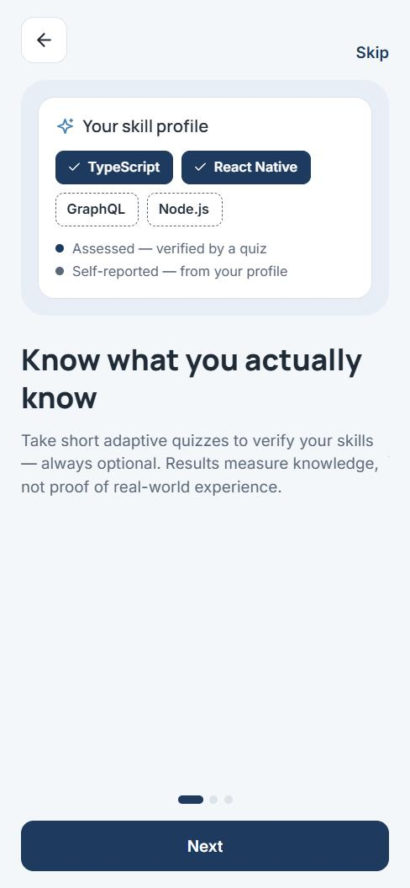
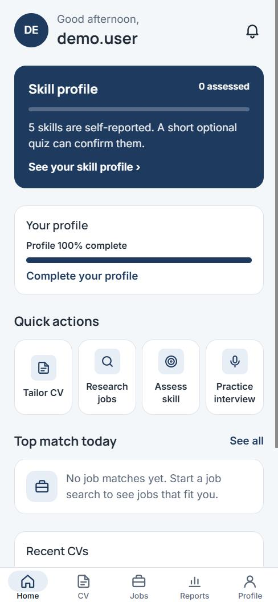
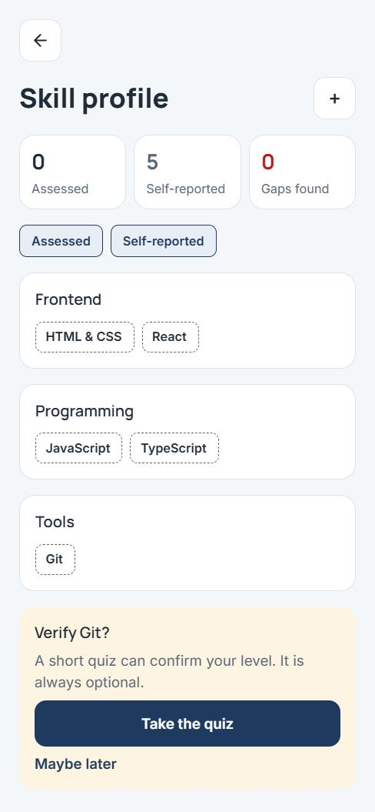
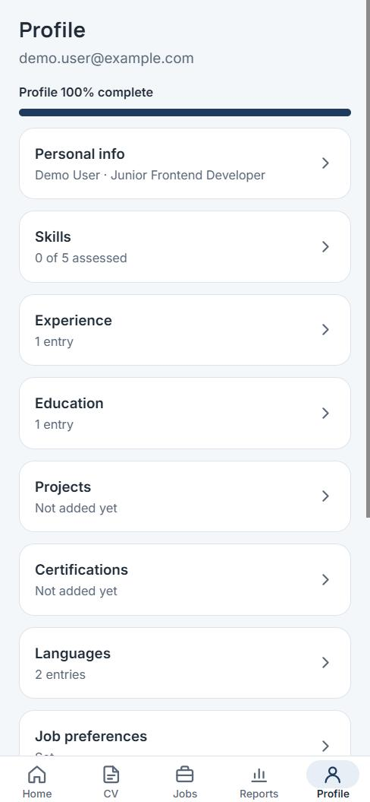
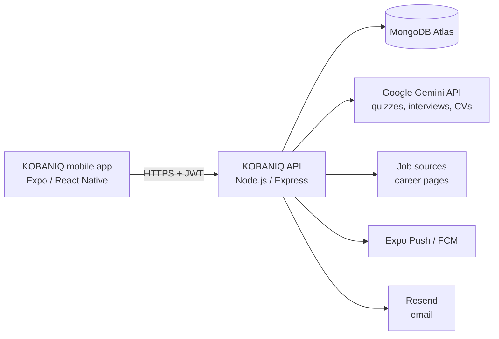

<div align="center">

# KOBANIQ

**Know your skills. Find your opportunity.**

A bilingual (English / Somali) career app for job seekers in Somaliland and Somalia: build a skill profile, verify skills with short quizzes, practise interviews, find matching jobs and create tailored CVs.


</div>

---

## Contents

1. [Overview](#overview)
2. [Screenshots](#screenshots)
3. [Features](#features)
4. [How it works](#how-it-works)
5. [Tech stack](#tech-stack)
6. [Project structure](#project-structure)
7. [Getting started](#getting-started)
8. [Environment variables](#environment-variables)
9. [Scripts and tests](#scripts-and-tests)
10. [Deployment](#deployment)
11. [Security and privacy](#security-and-privacy)
12. [Status and limitations](#status-and-limitations)
13. [Roadmap](#roadmap)
14. [Author](#author)

## Overview

Many job seekers in Somaliland and Somalia have skills that never show up on paper, and job adverts are scattered across company pages, NGO sites and social media. KOBANIQ is a mobile app that helps people:

- describe what they can do in a structured **skill profile**,
- **verify** those skills with short adaptive quizzes (always optional),
- **practise interviews**,
- **find jobs** that fit their skills and preferences, and
- generate a **tailored CV** for a specific job, exportable as PDF.

The whole app works in **English and Somali**.

## Screenshots

> Real screens from the KOBANIQ mobile app, run locally with a demo account and fictional sample data (390 × 844 phone viewport).

<table>
  <tr>
    <td align="center" width="25%">
      <br />
      <sub><b>Onboarding:</b> explains self-reported vs. quiz-verified skills before sign-up.</sub>
    </td>
    <td align="center" width="25%">
      <br />
      <sub><b>Home:</b> skill profile summary, profile completion and quick actions (Tailor CV, Research jobs, Assess skill, Practice interview).</sub>
    </td>
    <td align="center" width="25%">
      <br />
      <sub><b>Skill profile:</b> skills grouped by category, assessed vs. self-reported, with an optional quiz to verify a skill.</sub>
    </td>
    <td align="center" width="25%">
      <br />
      <sub><b>Profile:</b> personal info, skills, experience, education, projects, certifications, languages and job preferences.</sub>
    </td>
  </tr>
</table>

## Features

**Account and language**

- Email + password sign-up and sign-in, Google sign-in, password reset, optional email verification.
- English or Somali, chosen at the start and changeable at any time.

**Profile and skills**

- Profile sections: personal info, experience, education, projects, certifications, languages and job preferences (titles, regions, work modes, job and employer types).
- Skills with a self-reported level (beginner to expert) and years of experience.

**AI features** (Google Gemini, called only by the backend)

- **Skill quizzes:** short adaptive quizzes that set an assessed level and list skill gaps. Results measure knowledge, not proof of experience.
- **Interview practice:** AI-generated interview questions with typed answers and feedback.
- **Tailored CVs:** generate a CV for a job description, edit it, approve it and download it as a **PDF**.

**Jobs**

- Job research runs, on demand or on a schedule, that collect jobs from the selected sources and match them to the user's skills and preferences.
- Save jobs, see match strength and the skills that are missing.

**Other**

- Personal progress reports.
- In-app and push notifications (Expo Notifications, with Firebase Cloud Messaging on Android).

## How it works



- The app never talks to Gemini or the database directly. All AI calls go through the API, which holds the keys.
- Access tokens are short-lived and kept in memory. Refresh tokens rotate on every use and are stored in the phone's secure storage (Keychain / Keystore).
- Shared types and the English/Somali translations live in `packages/shared`.

## Tech stack

| Area       | Technologies                                                                                                           |
| ---------- | ---------------------------------------------------------------------------------------------------------------------- |
| Mobile app | Expo SDK 58, React Native 0.88, React 19, Expo Router, TypeScript, i18next, zod, Expo Secure Store, Expo Notifications |
| API        | Node.js, Express, TypeScript, Mongoose, JSON Web Tokens, bcrypt, zod, pdfkit, `@google/genai`                          |
| Database   | MongoDB Atlas                                                                                                          |
| Tooling    | npm workspaces, ESLint 9, Prettier, Husky, Jest (mobile), `node:test` (API), GitHub Actions CI                         |
| Hosting    | Render (API, free plan), Vercel (website)                                                                              |

## Project structure

```text
koobanIQ/
├── app-frontend/      # KOBANIQ mobile app (Expo / React Native)
│   └── src/app/       #   screens (Expo Router): (auth) sign-up flow, (app) tabs and detail screens
├── backend/           # REST API (Express + TypeScript + MongoDB)
│   ├── src/ai/        #   Gemini provider, prompts and response schemas
│   ├── src/jobs/      #   job sources, normalisation and matching
│   └── test/          #   API tests
├── packages/shared/   # shared types and English/Somali translations
├── Admin-dashboard/   # internal admin tool
├── landing/           # public website
├── render.yaml        # Render blueprint for the API
└── vercel.json        # Vercel config for the website
```

## Getting started

**Requirements:** Node.js 20+ (CI uses 24), npm, a MongoDB database (the MongoDB Atlas free tier works), and Expo Go on a phone or an Android/iOS emulator.

```bash
git clone https://github.com/apdizalam/koobanIQ.git
cd koobanIQ
npm install
```

**1. Start the API**

```bash
cp backend/.env.example backend/.env   # then fill in your own values (see below)
npm run dev:server                     # http://localhost:5000
```

**2. Start the mobile app**

```bash
cp app-frontend/.env.example app-frontend/.env
# set EXPO_PUBLIC_API_URL=http://<your computer's Wi-Fi IP>:5000/api/v1
npm run dev:mobile                     # scan the QR code with Expo Go
```

The phone and the computer must be on the same Wi-Fi network.

## Environment variables

Real values go in `backend/.env` and `app-frontend/.env`, which are git-ignored. Never commit them. The full annotated list is in [`backend/.env.example`](backend/.env.example).

| Variable                                                          | Where   | Purpose                                              |
| ----------------------------------------------------------------- | ------- | ---------------------------------------------------- |
| `MONGODB_URI`, `MONGODB_DB_NAME`                                  | backend | Database connection                                  |
| `JWT_ACCESS_SECRET`, `JWT_ACCESS_TTL`, `REFRESH_TOKEN_DAYS`       | backend | Sessions (the secret is required in production)      |
| `AI_PROVIDER`, `GEMINI_API_KEY`, `GEMINI_MODEL`                   | backend | AI features (Gemini free tier)                       |
| `RESEND_API_KEY`, `EMAIL_FROM`                                    | backend | Email (verification codes, password reset)           |
| `GOOGLE_CLIENT_ID`, `GOOGLE_CLIENT_SECRET`, `GOOGLE_REDIRECT_URI` | backend | Google sign-in                                       |
| `EXPO_PUBLIC_API_URL`                                             | mobile  | API base URL, e.g. `http://192.168.1.10:5000/api/v1` |

## Scripts and tests

Run from the repository root:

| Command                                 | What it does                                                  |
| --------------------------------------- | ------------------------------------------------------------- |
| `npm run dev:server`                    | API with live reload                                          |
| `npm run dev:mobile`                    | Expo dev server for the mobile app                            |
| `npm run lint` / `npm run format:check` | ESLint / Prettier                                             |
| `npm run typecheck`                     | TypeScript in every workspace                                 |
| `npm test`                              | Tests in every workspace (the API tests need a test database) |

CI (`.github/workflows/ci.yml`) runs lint, format, typecheck, build and the API tests.

## Deployment

- **API:** `render.yaml` defines a Render web service on the free plan. It deploys `main` after CI passes, and secrets are entered in the Render dashboard. On the free plan the server sleeps after about 15 minutes without traffic.
- **Mobile app:** built with Expo. Android push notifications use the Firebase client config in `app-frontend/google-services.json`, which is a public app identifier, not a secret.

## Security and privacy

- Passwords are hashed with bcrypt. Sessions use short-lived JWT access tokens and single-use, rotating refresh tokens.
- AI keys and database credentials live only on the server; the app never receives them.
- **Users' profile data is not sent to the AI by default.** While KOBANIQ runs on the Gemini free tier, features that would send a profile (such as CV generation) are blocked for real accounts unless an admin explicitly allows it.
- `.env` files are git-ignored; only `.env.example` files with placeholders are committed.
- To report a security issue, please contact the author privately instead of opening a public issue.

## Status and limitations

KOBANIQ is in **active development** and not yet published on the app stores.

- **Job sources:** only **company and NGO career pages that are added to the app** are searched automatically today. ReliefWeb, UN Careers, Remotive, Arbeitnow, LinkedIn and Facebook are listed but not active yet: each needs approval, permission or a paid API first.
- **AI:** runs on the Gemini free tier, so there are daily limits; when they are reached, AI features pause until the next day. CV generation for real accounts is off by default (see [Security and privacy](#security-and-privacy)).
- **Server:** the free Render plan sleeps when idle, so the first request after a pause can take about a minute.
- **Quizzes** measure knowledge of a skill; they are not proof of real-world experience.

## Roadmap

- Activate more job sources as their terms allow.
- A paid AI tier with verified privacy terms, so CV generation can be enabled for everyone.
- App store releases (Android first).

## Author

**Abdisalam Mohamed** · [GitHub](https://github.com/apdizalam)
